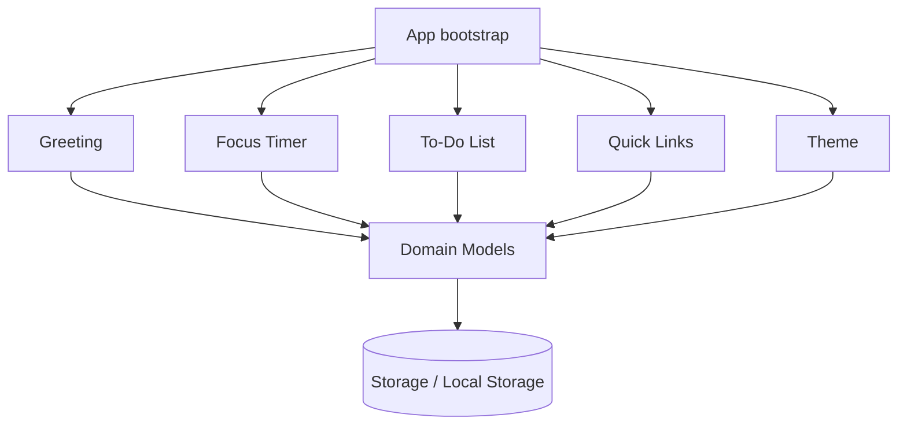

# Design Document — Personal Dashboard

## Overview

The Personal Dashboard is a single-page, client-side web application built with plain HTML, exactly one CSS file, and exactly one JavaScript file — no frameworks, no libraries, no backend. All user data (Tasks, Quick Links, Theme) is persisted through the browser Local Storage API. The same code base is deliverable two ways: as a standalone web app opened directly via `index.html`, and as a browser extension packaged with `manifest.json` (Manifest V3) for Chrome, Firefox, and Edge.

The application aggregates five components on one page:

1. **Greeting** — current time, current date, and a time-of-day greeting.
2. **Focus Timer** — a fixed 25:00 countdown with Start / Stop / Reset.
3. **To-Do List** — add / edit / mark-done / delete Tasks, persisted.
4. **Quick Links** — editable favorite-website buttons, persisted.
5. **Theme Toggle** — light / dark switch, persisted.

## Architecture

### 2.1 File Structure

```
/
├── index.html          # Single entry point; links css/styles.css and js/app.js
├── css/
│   └── styles.css      # Exactly one CSS file (all styling)
├── js/
│   └── app.js         # Exactly one JavaScript file (all logic)
└── manifest.json      # Browser extension manifest (Manifest V3)
```

The constraint of exactly one CSS file and one JS file means no module splitting across files. To preserve separation of concerns within that single JS file, `app.js` is organized into clearly delimited sections inside one top-level IIFE so it exposes nothing to the global scope except a single `Dashboard` namespace used only for testing hooks.

### 2.2 Layered Organization (within js/app.js)

The JavaScript is structured into four logical layers, each a plain object/module within the IIFE:

```
┌─────────────────────────────────────────────┐
│                  App (bootstrap)             │  wires DOM <-> controllers, init()
├─────────────────────────────────────────────┤
│   Controllers (per component)                │  Greeting, Timer, Todo, Links, Theme
│   - hold in-memory state, render to DOM       │
├─────────────────────────────────────────────┤
│   Domain Models (pure)                       │  Task, QuickLink, Theme helpers
│   - creation, update, validation functions    │
├─────────────────────────────────────────────┤
│   Storage Layer                              │  Storage wrapper over Local Storage
│   - load/save with graceful failure          │
└─────────────────────────────────────────────┘
```

**Dependency direction:** App → Controllers → Domain Models → Storage. Controllers depend on the pure domain functions for state transitions and on Storage for persistence. Domain models have no DOM or storage dependencies, which keeps the core logic pure and directly testable as properties.

### 2.3 Component Diagram



## Components and Interfaces

Each component is described by its in-memory state, its public methods, and the pure functions it delegates to. Pure functions (marked "pure") are the primary targets for property-based testing.

### 3.1 Storage Layer

A thin wrapper over the Local Storage API that centralizes all reads/writes and makes failures non-fatal.

```js
const Storage = {
  KEYS: { tasks: 'dashboard.tasks', links: 'dashboard.quickLinks', theme: 'dashboard.theme' },

  isAvailable() {
    try {
      const k = '__dash_test__';
      localStorage.setItem(k, '1'); localStorage.removeItem(k);
      return true;
    } catch { return false; }
  },

  // Returns parsed value or `fallback`. Never throws.
  load(key, fallback) {
    try {
      const raw = localStorage.getItem(key);
      return raw === null ? fallback : JSON.parse(raw);
    } catch { return fallback; }
  },

  // Returns true on success, false on failure. Never throws.
  save(key, value) {
    try { localStorage.setItem(key, JSON.stringify(value)); return true; }
    catch { return false; }
  },

  // Returns true on success, false on failure. Never throws.
  remove(key) {
    try { localStorage.removeItem(key); return true; }
    catch { return false; }
  }
};
```

### 3.2 Domain Models (pure)

```js
// Greeting (pure)
const GreetingModel = {
  greetingForHour(hour) {            // hour: 0-23
    if (hour >= 5  && hour <= 11) return 'Good morning';
    if (hour >= 12 && hour <= 16) return 'Good afternoon';
    if (hour >= 17 && hour <= 20) return 'Good evening';
    return 'Good night';             // 21-23 and 0-4
  },
  greetingForDate(date) {
    return this.greetingForHour(date.getHours());
  },
  formatTime(date)   { /* HH:MM, 24h, zero-padded */ },
  formatDate(date)   { /* e.g. "Monday, 5 May 2025" */ }
};

// Task (pure)
const TaskModel = {
  create(text)   { return { id: uid(), text, done: false }; },
  setText(t, text) { return { ...t, text }; },
  toggleDone(t)  { return { ...t, done: !t.done }; },
  isValidText(text) { return typeof text === 'string' && text.trim().length > 0; }
};

// QuickLink (pure)
const LinkModel = {
  create(name, url) { return { id: uid(), name, url }; },
  setName(l, name)  { return { ...l, name }; },
  setUrl(l, url)    { return { ...l, url }; }
};

// Theme (pure)
const ThemeModel = {
  toggle(theme) { return theme === 'dark' ? 'light' : 'dark'; },
  defaultTheme() { return 'light'; }
};

// Timer (pure)
const TimerModel = {
  INITIAL_SECONDS: 25 * 60,           // 1500
  reset()             { return { seconds: this.INITIAL_SECONDS, running: false, complete: false }; },
  start(state)        { return state.complete ? state : { ...state, running: true }; },
  stop(state)         { return { ...state, running: false }; },
  // advance one second; stops and marks complete at zero
  tick(state) {
    if (!state.running) return state;
    const next = state.seconds - 1;
    if (next <= 0) return { seconds: 0, running: false, complete: true };
    return { ...state, seconds: next };
  },
  format(seconds) { /* MM:SS */ }
};
```

`uid()` generates a unique id via `crypto.randomUUID()` when available, falling back to a timestamp+random string.

### 3.3 Controllers

Each controller owns its in-memory collection, renders to a DOM root, and persists through Storage.

```js
const GreetingCtrl = {
  init(root) { this.root = root; this.update(); setInterval(() => this.update(), 1000 /*<=1min req 3.6*/); },
  update() { const d = new Date(); /* render time, date, greeting */ }
};

const TimerCtrl = {
  state: TimerModel.reset(),
  intervalId: null,
  init(root) { this.root = root; this.render(); /* bind Start/Stop/Reset */ },
  start()  { this.state = TimerModel.start(this.state); this.run(); this.render(); },
  stop()   { this.state = TimerModel.stop(this.state); this.stopRun(); this.render(); },
  reset()  { this.state = TimerModel.reset(); this.stopRun(); this.render(); },
  run()    { if (this.intervalId == null) this.intervalId = setInterval(() => this.step(), 1000); },
  stopRun(){ if (this.intervalId != null) { clearInterval(this.intervalId); this.intervalId = null; } },
  step()   { this.state = TimerModel.tick(this.state); if (this.state.complete) this.stopRun(); this.render(); }
};

const TodoCtrl = {
  tasks: [],
  init(root) { this.root = root; this.tasks = Storage.load(Storage.KEYS.tasks, []); this.render(); },
  addTask(text) {
    if (!TaskModel.isValidText(text)) { this.notifyRejected(); return; }
    this.tasks.push(TaskModel.create(text.trim()));
    this.persist(); this.render();
  },
  editTask(id, text) {
    this.tasks = this.tasks.map(t => t.id === id ? TaskModel.setText(t, text) : t);
    this.persist(); this.render();
  },
  toggleDone(id) {
    this.tasks = this.tasks.map(t => t.id === id ? TaskModel.toggleDone(t) : t);
    this.persist(); this.render();
  },
  deleteTask(id) {
    this.tasks = this.tasks.filter(t => t.id !== id);
    this.persist(); this.render();
  },
  persist() { Storage.save(Storage.KEYS.tasks, this.tasks); }
};

const LinksCtrl = {
  links: [],
  init(root) { this.root = root; this.links = Storage.load(Storage.KEYS.links, []); this.render(); },
  addLink(name, url)    { this.links.push(LinkModel.create(name, url)); this.persist(); this.render(); },
  editLink(id, name, url){ this.links = this.links.map(l => l.id === id ? { ...l, name, url } : l); this.persist(); this.render(); },
  removeLink(id)        { this.links = this.links.filter(l => l.id !== id); this.persist(); this.render(); },
  openLink(url)         { window.open(url, '_blank', 'noopener'); },
  persist() { Storage.save(Storage.KEYS.links, this.links); }
};

const ThemeCtrl = {
  theme: 'light',
  init(root) { this.root = root; this.theme = Storage.load(Storage.KEYS.theme, ThemeModel.defaultTheme()); this.apply(); /* bind toggle */ },
  toggle() { this.theme = ThemeModel.toggle(this.theme); this.persist(); this.apply(); },
  apply()  { document.documentElement.setAttribute('data-theme', this.theme); },
  persist(){ Storage.save(Storage.KEYS.theme, this.theme); }
};

const App = {
  init() {
    ThemeCtrl.init(document.getElementById('theme-toggle'));
    GreetingCtrl.init(document.getElementById('greeting'));
    TimerCtrl.init(document.getElementById('timer'));
    TodoCtrl.init(document.getElementById('todo'));
    LinksCtrl.init(document.getElementById('links'));
  }
};
document.addEventListener('DOMContentLoaded', App.init);
```

## Data Models

### 4.1 In-Memory Types

```ts
// Task
interface Task {
  id: string;     // unique identifier
  text: string;   // non-empty description
  done: boolean;  // completion status
}

// QuickLink
interface QuickLink {
  id: string;     // unique identifier
  name: string;   // display name
  url: string;    // target URL
}

// Theme
type Theme = 'light' | 'dark';

// TimerState (in-memory, not persisted)
interface TimerState {
  seconds: number;    // remaining seconds, 0..1500
  running: boolean;   // is the countdown active
  complete: boolean;  // did it reach 00:00
}
```

### 4.2 Local Storage Schema

| Key                     | JSON value                  | Default when absent/unreadable |
|-------------------------|-----------------------------|--------------------------------|
| `dashboard.tasks`       | `Task[]`                    | `[]`                           |
| `dashboard.quickLinks`  | `QuickLink[]`               | `[]`                           |
| `dashboard.theme`       | `"light"` or `"dark"`       | `"light"`                      |

The Focus Timer is intentionally **not** persisted; it always initializes to 25:00 on load (Requirement 4.1).

## Error Handling

| Scenario | Behavior |
|----------|----------|
| Local Storage unavailable (private mode, disabled) | `Storage.isAvailable()` returns false; controllers fall back to in-memory-only state for the session; no crash, no thrown errors (Req 2.3). |
| `setItem` / `getItem` throws (quota, serialization) | `Storage.save`/`load` catch and return `false`/`fallback`; the UI continues to render and operate for the session (Req 2.3). |
| Corrupt JSON in storage | `JSON.parse` failure is caught by `Storage.load`; the configured fallback (`[]` or `'light'`) is used. |
| Empty / whitespace-only task text | `TaskModel.isValidText` rejects; controller calls `notifyRejected()` (inline message) and does not mutate the list (Req 5.6). |
| Timer at 00:00 | `TimerModel.tick` sets `running:false`, `complete:true`; the interval is cleared; a "session complete" indicator is shown (Req 4.5). |

## Browser Extension Packaging

`manifest.json` uses Manifest V3 (supported by Chrome, Firefox, and Edge). The dashboard is exposed as a toolbar popup; opening `index.html` directly also works as a standalone page, satisfying Requirement 8.

```json
{
  "manifest_version": 3,
  "name": "Personal Dashboard",
  "version": "1.0.0",
  "description": "A personal dashboard with a greeting clock, 25-minute focus timer, to-do list, quick links, and theme toggle.",
  "action": {
    "default_popup": "index.html",
    "default_title": "Personal Dashboard"
  },
  "icons": { "16": "icons/icon16.png", "48": "icons/icon48.png", "128": "icons/icon128.png" }
}
```

`index.html` loads assets with relative paths (`css/styles.css`, `js/app.js`) so the same file works both via `file://` and inside the extension popup.

## Correctness Properties

*A property is a characteristic or behavior that should hold true across all valid executions of a system — essentially, a formal statement about what the system should do. Properties serve as the bridge between human-readable specifications and machine-verifiable correctness guarantees.*

The properties below are derived from the prework analysis. Pure domain functions (`GreetingModel`, `TaskModel`, `LinkModel`, `ThemeModel`, `TimerModel`) and the `Storage` layer are the primary targets, because their behavior is deterministic and input-varying. DOM-rendering and browser-extension behavior are covered by example/integration tests described in Section 8.

### Property 1: Greeting displays the current time and date

For any `Date` value, the Greeting component's rendered output contains a formatted time string and a formatted date string that correspond to that `Date`.

**Validates: Requirements 3.1**

### Property 2: Greeting period matches the hour of day

For any hour of the day (0–23), the greeting returned by `GreetingModel.greetingForHour` matches the time-of-day period: morning for 05:00–11:59, afternoon for 12:00–16:59, evening for 17:00–20:59, and night for 21:00–04:59 (including the midnight wrap-around).

**Validates: Requirements 3.2, 3.3, 3.4, 3.5**

### Property 3: Timer reset always canonicalizes to 25:00

For any timer state (any remaining seconds, running or not, complete or not), applying `TimerModel.reset` yields a state whose `seconds` equals 1500 (25:00), `running` is false, and `complete` is false. This also covers the initial display value on a fresh load.

**Validates: Requirements 4.1, 4.4**

### Property 4: Timer Start counts down from the currently displayed time

For any non-complete timer state, `TimerModel.start` sets `running` to true without changing `seconds`, and each subsequent `tick` decrements `seconds` by exactly one until reaching zero.

**Validates: Requirements 4.2**

### Property 5: Timer Stop pauses and retains the displayed time

For any running timer state, `TimerModel.stop` sets `running` to false and leaves `seconds` unchanged; further `tick` calls do not alter `seconds`.

**Validates: Requirements 4.3**

### Property 6: Timer stops and signals completion at zero

For any running countdown, repeatedly applying `tick` reaches a state where `seconds` is 0, `running` is false, and `complete` is true, and `tick` applied after that point leaves the state unchanged.

**Validates: Requirements 4.5**

### Property 7: Adding a valid task grows the list by exactly one

For any task list and any valid (non-whitespace) task text, adding the task increases the list length by exactly one, the new task is present in the list with `done` equal to false, and the persisted storage contains the same list.

**Validates: Requirements 5.1**

### Property 8: Task update modifies only the specified field

For any task, updating its text via `TaskModel.setText` changes only the `text` field (id and done preserved), and toggling done via `TaskModel.toggleDone` changes only the `done` field (id and text preserved). The updated value is persisted.

**Validates: Requirements 5.2, 5.3**

### Property 9: Deleting a task removes exactly that task

For any task list containing a target task, deleting the target decreases the list length by exactly one, the target is absent from the resulting list, all other tasks are preserved, and the persisted storage no longer contains the target.

**Validates: Requirements 5.4**

### Property 10: Whitespace-only task text is rejected

For any string composed entirely of whitespace (spaces, tabs, newlines, or any mixture), `TaskModel.isValidText` returns false, the submission is rejected, and the task list is unchanged.

**Validates: Requirements 5.6**

### Property 11: Adding a valid quick link grows the list by exactly one

For any quick-link list and any valid quick link (name and url), adding the link increases the list length by exactly one, the new link is present in the list, and the persisted storage contains the same list.

**Validates: Requirements 6.1**

### Property 12: Quick link update modifies only the specified field(s)

For any quick link, `LinkModel.setName` changes only `name` (id and url preserved) and `LinkModel.setUrl` changes only `url` (id and name preserved). The updated value is persisted.

**Validates: Requirements 6.3**

### Property 13: Removing a quick link removes exactly that link

For any quick-link list containing a target link, removing the target decreases the list length by exactly one, the target is absent from the resulting list, all other links are preserved, and the persisted storage no longer contains the target.

**Validates: Requirements 6.4**

### Property 14: Theme toggle switches to the other theme

For any theme value (`'light'` or `'dark'`), `ThemeModel.toggle` returns the other theme value; applying toggle twice returns the original theme (involution).

**Validates: Requirements 7.1**

### Property 15: Task list persistence round-trip

For any list of Tasks, saving it through the Storage layer and then loading it back produces an equivalent list (same length and element-wise equal on id, text, and done).

**Validates: Requirements 2.1, 2.2, 5.5**

### Property 16: Quick link persistence round-trip

For any list of Quick Links, saving it through the Storage layer and then loading it back produces an equivalent list (same length and element-wise equal on id, name, and url).

**Validates: Requirements 2.1, 2.2, 6.5**

### Property 17: Theme persistence round-trip with light default

For any theme value (`'light'` or `'dark'`), saving it through the Storage layer and loading it back returns the same value; when no theme has been stored (or storage is unreadable), loading returns `'light'` as the default.

**Validates: Requirements 2.1, 2.2, 7.2, 7.3, 7.4**

### Property 18: Storage failure does not crash the dashboard

For any sequence of operations (add/edit/delete task, add/edit/remove link, toggle theme) performed while the Local Storage API is unavailable or every write throws, none of the operations throw an exception, and the dashboard continues to render and operate on in-memory state for the session.

**Validates: Requirements 2.3**

## Testing Strategy

### 8.1 Property-Based Tests (pure layers)

Targets: `GreetingModel`, `TaskModel`, `LinkModel`, `ThemeModel`, `TimerModel`, and the `Storage` layer (with an injected mock Local Storage). Minimum 100 iterations per property. Each test is tagged `**Feature: personal-dashboard, Property N: <text>**` and references its design property.

Generators:
- `hour`: integers 0–23 (Properties 2).
- `Date`: random timestamps across a multi-day span including day and period boundaries (Properties 1, 2).
- `Task` / `Task[]`: random ids, non-empty text, random done flag (Properties 7–9, 15).
- `QuickLink` / `QuickLink[]`: random ids, names, urls (Properties 11–13, 16).
- `theme`: `'light'` | `'dark'`; plus the empty/missing-storage case (Properties 14, 17).
- `TimerState`: random `seconds` 0–1500, running/complete flags (Properties 3–6).
- Whitespace strings: combinations of `' '`, `'\t'`, `'\n'`, `'\r'`, empty string (Property 10).
- Failing storage mock: `localStorage` undefined, or `setItem`/`getItem` throwing (Property 18).

### 8.2 Example / Unit Tests

- Fresh timer displays 25:00 (Req 4.1).
- Marking a task done visually distinguishes it (Req 5.3) — DOM class assertion.
- Activating a quick link opens the URL (Req 6.2) — mock `window.open`, assert called with the link's url.

### 8.3 Edge Cases

- Day boundary (23:59 → 00:00 next day) updates the displayed date (Req 3.7) — covered by Property 1 generator range.
- Period boundary transitions update the greeting (Req 3.8) — covered by Property 2 generator range.
- Empty/missing theme storage defaults to light (Req 7.4) — covered by Property 17.

### 8.4 Integration / Smoke Tests (not PBT)

- File structure: `index.html`, `css/styles.css`, `js/app.js` exist and are wired (Req 1.1); no external framework/library/backend references (Req 1.2); `manifest.json` is valid Manifest V3 (Req 1.3, 8.2).
- Standalone open: load `index.html` over `file://` and render without console errors (Req 8.1, 9.2).
- Extension: load unpacked in Chrome/Firefox/Edge and assert it renders (Req 8.2).
- Refresh cadence: greeting refresh interval ≤ 60000 ms (Req 3.6).
- Performance: initial render < 1 s (Req 10.1); interaction update < 100 ms (Req 10.2) — measured in a real browser, 1–3 runs.
